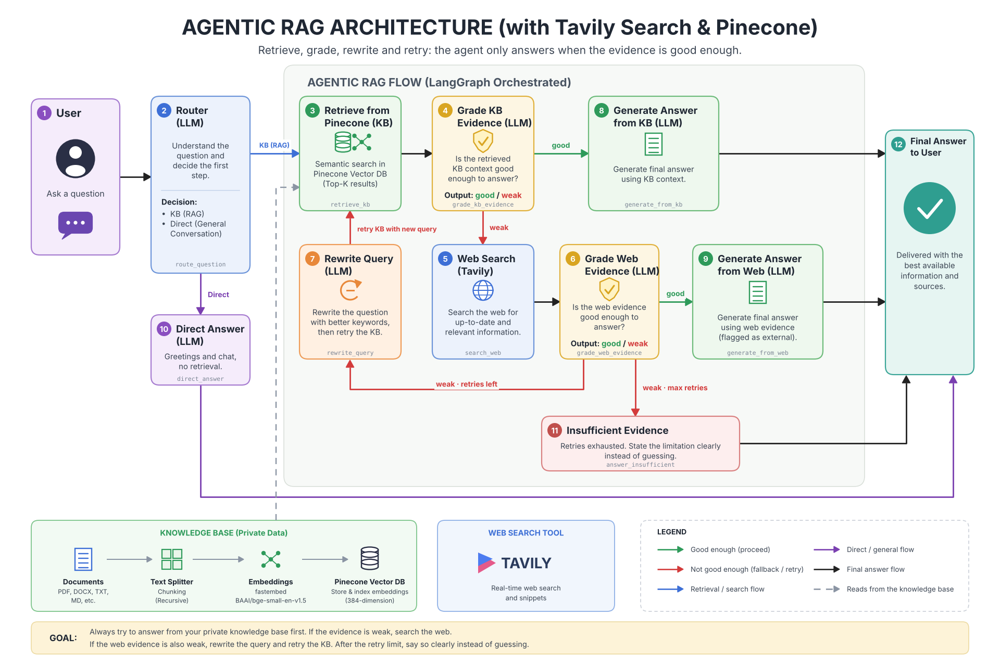

# EvidenceFirst HR Copilot

An agentic RAG assistant for HR policy and employee support. It answers from the company's **private HR knowledge base first**, checks whether the evidence is good enough, and only then falls back to web search. If the evidence is still weak, it rewrites the query and retries instead of guessing.

**Live demo:** https://evidencefirst-hr-copilot.onrender.com

>> **Note:** This project is deployed on Render's free tier. The backend may go to sleep after a period of inactivity. When you open the application for the first time or after inactivity, please wait up to **2 minutes** for the backend to spin up. The first response may take longer than usual.

---

## Why this project

Employees keep asking HR the same questions because they don't know which policy applies to them, keyword search returns too many documents, and a normal chatbot can confidently invent policy details.

EvidenceFirst HR Copilot solves this by:

- Searching the trusted private HR knowledge base first.
- Grading the retrieved evidence before answering.
- Using web search (Tavily) only when private knowledge is weak, and labelling that answer as external information that needs HR validation.
- Rewriting weak queries and retrying the knowledge base.
- Saying "insufficient evidence" instead of hallucinating.
- Showing the full LangGraph decision path for transparency and debugging.
- Letting an authorized HR admin upload new documents (PDF, TXT, Markdown, DOCX).

---

## Architecture and overall flow



**How a question moves through the graph**

1. **Router (`route_question`)**: greetings and casual chat go to `direct_answer`; HR questions go to the knowledge base.
2. **Retrieve (`retrieve_kb`)**: semantic search in Pinecone (top-K chunks).
3. **Grade KB evidence (`grade_kb_evidence`)**: good goes to `generate_from_kb`; weak goes to web search.
4. **Web search (`search_web`)**: Tavily fetches current public information.
5. **Grade web evidence (`grade_web_evidence`)**: good goes to `generate_from_web`; weak goes to the retry loop.
6. **Rewrite query (`rewrite_query`)**: improves the question and sends it back to `retrieve_kb`.
7. **Insufficient evidence (`answer_insufficient`)**: once the retry limit is reached, the app says it cannot answer confidently.
8. **Final answer**: returned with the answer, source type, citations and the decision trace.

---

## Tech stack

| Layer | Technology |
|---|---|
| Agent workflow | LangGraph |
| LLM | Google Gemini (`langchain-google-genai`) |
| Embeddings | fastembed, `BAAI/bge-small-en-v1.5` (384 dimensions) |
| Vector database | Pinecone |
| Web search | Tavily |
| Backend API | FastAPI, Uvicorn |
| Audit log | SQLite |
| Frontend | React, Vite, Tailwind CSS |
| Hosting | Render (Web Service + Static Site) |

---

## Project structure

```
EvidenceFirst-HR-Copilot/
├── backend/
│   ├── app/
│   │   ├── api/routes.py           # /api/chat, /api/ingest
│   │   ├── core/config.py          # settings read from .env
│   │   ├── core/logging.py
│   │   ├── rag/state.py            # graph state and schemas
│   │   ├── rag/vectorstore.py      # Pinecone + fastembed
│   │   ├── rag/workflow.py         # LangGraph agentic workflow
│   │   ├── services/audit.py       # SQLite decision-path log
│   │   ├── services/ingestion.py   # load and chunk documents
│   │   └── main.py                 # FastAPI app
│   ├── data/sample_kb/             # sample HR documents
│   ├── uploads/                    # temporary uploaded files
│   ├── ingest_sample_kb.py         # first-time ingestion script
│   ├── requirements.txt
│   └── run.py
├── frontend/
│   ├── src/
│   │   ├── api/client.js
│   │   ├── hooks/useChat.js
│   │   ├── components/             # Sidebar, ChatWindow, TracePanel, UploadModal, ...
│   │   ├── App.jsx
│   │   └── main.jsx
│   ├── index.html
│   ├── package.json
│   └── vite.config.js
├── docs/
│   └── agentic_rag_architecture.png
└── README.md
```

---

## Local setup

Set up the **backend completely first**, then the frontend.

### Prerequisites

- **Python 3.12** (recommended). Python 3.14 is not supported yet by `langchain-pinecone`, so installation fails on it.
- **Node.js 18 or newer** and npm
- Git
- API keys:
  - [Google AI Studio](https://aistudio.google.com/) for `GEMINI_API_KEY`
  - [Tavily](https://tavily.com/) for `TAVILY_API_KEY`
  - [Pinecone](https://www.pinecone.io/) for `PINECONE_API_KEY`
  - [Hugging Face](https://huggingface.co/settings/tokens) for `HUGGINGFACEHUB_API_TOKEN` (used to download the embedding model)

### Step 1: Clone the repository

```bash
git clone https://github.com/nitishgarg1/EvidenceFirst-HR-Copilot.git
cd EvidenceFirst-HR-Copilot
```

---

## Part 1: Backend

### 1.1 Create a virtual environment and install dependencies

```bash
cd backend
python -m venv venv
```

Activate it:

```bash
# macOS / Linux
source venv/bin/activate

# Windows (PowerShell)
venv\Scripts\Activate.ps1
```

Install the packages:

```bash
pip install -r requirements.txt
```

### 1.2 Create `backend/.env`

Create a file named `.env` **inside the `backend/` folder** and add your own values. Do not wrap the values in quotes unless shown, and never commit this file.

```env
# LLM
GEMINI_API_KEY=your_gemini_api_key
GEMINI_MODEL=gemini-3.1-flash-lite

# Web search
TAVILY_API_KEY=your_tavily_api_key

# Embeddings (fastembed)
EMBEDDING_MODEL=BAAI/bge-small-en-v1.5
HUGGINGFACEHUB_API_TOKEN=your_huggingface_token

# Pinecone vector database
PINECONE_API_KEY=your_pinecone_api_key
PINECONE_INDEX_NAME=fde-hr-policy-rag
PINECONE_NAMESPACE=company-hr-kb

# Admin password for uploading documents (change this!)
ADMIN_API_KEY=choose-a-long-random-password

# Frontend origin(s) allowed to call the API (comma separated)
CORS_ORIGINS=http://localhost:5173

# Optional: LangSmith tracing
LANGCHAIN_TRACING=true
LANGCHAIN_ENDPOINT=https://api.smith.langchain.com
LANGCHAIN_API_KEY=your_langsmith_api_key
LANGCHAIN_PROJECT=ENTERPRISE_HR_COPILOT
```

Notes:

- `ADMIN_API_KEY` is the password HR staff type in the app to upload documents (see [Uploading documents as admin](#uploading-documents-as-admin)). If you leave it unset, the insecure default `change-me-in-production` is used, so always set your own.
- The Pinecone index is created automatically with 384 dimensions, which matches the embedding model. If you change `EMBEDDING_MODEL` later, use a new `PINECONE_INDEX_NAME` or delete the old index, because vector sizes must match.
- The `LANGCHAIN_*` lines are optional and only needed if you want LangSmith tracing.

### 1.3 Load the sample knowledge base (first-time ingestion)

Run this **once**, with the virtual environment active and from the `backend/` folder:

```bash
python ingest_sample_kb.py
```

This reads the sample HR documents in `data/sample_kb/`, splits them into chunks, embeds them with fastembed and stores them in Pinecone. The first run also downloads the embedding model, so it takes a little longer. You only need to repeat it if you point the app at a new Pinecone index.

### 1.4 Start the backend

```bash
python run.py
```

Or run Uvicorn directly:

```bash
uvicorn app.main:app --reload --port 8080
```

The backend runs on **http://127.0.0.1:8080**. Check that it works:

- Health check: http://127.0.0.1:8080/health
- API docs: http://127.0.0.1:8080/docs

Keep this terminal running and open a new terminal for the frontend.

---

## Part 2: Frontend

Do this only after the backend is running.

### 2.1 Install dependencies

```bash
cd frontend
npm install
```

### 2.2 Create `frontend/.env`

Create a file named `.env` **inside the `frontend/` folder**:

```env
VITE_API_URL=http://127.0.0.1:8080
```

Use the address and port where your backend is running, with no trailing slash. Vite reads this file only at startup, so restart `npm run dev` after changing it. The variable name must start with `VITE_`.

### 2.3 Start the frontend

```bash
npm run dev
```

Open **http://localhost:5173** and ask a question, for example:

- "How many annual leave days do employees receive?"
- "What is our remote work policy?"
- "What are the latest public holiday rules in India?" (this one needs the web fallback)

The **Agent Trace** panel on the right shows each LangGraph step while the request runs.

If the page loads but questions fail, open the browser's developer console. A CORS error means the frontend address is missing from `CORS_ORIGINS` in `backend/.env`. If you open the app at `http://127.0.0.1:5173` instead of `localhost`, add that origin too.

### 2.4 Production build (optional)

```bash
npm run build
```

The static files are created in `frontend/dist`.

---

## Uploading documents as admin

Only people with the admin key can add documents to the knowledge base.

1. Make sure `ADMIN_API_KEY` is set in `backend/.env`, and restart the backend if you changed it.
2. In the app, click **+ Add HR Document** in the left sidebar.
3. Type the same value as `ADMIN_API_KEY` into the **Admin API key** field.
4. Choose a file (`.pdf`, `.txt`, `.md` or `.docx`) and click **Index Document**.
5. When it finishes, you see a message such as `Indexed e4.pdf: 17 chunks.` The document is now searchable.

A `401 Unauthorized` error means the key typed in the app doesn't match `ADMIN_API_KEY` on the server.

You can also upload from the command line:

```bash
curl -X POST http://127.0.0.1:8080/api/ingest \
  -H "X-Admin-Key: your_admin_api_key" \
  -F "file=@leave_policy.pdf"
```

Uploaded files are processed, embedded and stored in Pinecone. The copy saved in `backend/uploads/` is temporary and is not used for answering questions.

---

## API reference

| Method | Endpoint | Description |
|---|---|---|
| `POST` | `/api/chat` | Ask a question. Body: `{"question": "..."}` |
| `POST` | `/api/ingest` | Upload a document (multipart form, header `X-Admin-Key`) |
| `GET` | `/health` | Health check |
| `GET` | `/docs` | Interactive Swagger documentation |

Example `/api/chat` response:

```json
{
  "answer": "...",
  "source_used": "private_kb",
  "citations": [],
  "trace": [
    "Router -> KB",
    "Private KB retrieval -> 4 chunks",
    "KB evidence grade -> GOOD",
    "Answer generation -> PRIVATE KB"
  ]
}
```

`source_used` is one of `private_kb`, `web_search`, `direct` or `insufficient_evidence`.


---

## Troubleshooting

| Problem | Likely cause and fix |
|---|---|
| `langchain-pinecone` fails to install | You are on Python 3.14. Use Python 3.12. |
| `HUGGINGFACEHUB_API_TOKEN is missing` | Add the token to `backend/.env`. |
| `PINECONE_API_KEY is missing` | Add the key to `backend/.env` and restart the backend. |
| Index dimension mismatch error | The index was created with a different embedding model. Delete it or use a new `PINECONE_INDEX_NAME`, then run `ingest_sample_kb.py` again. |
| Frontend shows a CORS error | Add the frontend origin to `CORS_ORIGINS` and restart the backend. |
| Questions fail right after opening the app | The `VITE_API_URL` value is wrong, or the backend is still waking up. |
| `401` when uploading | The admin key doesn't match `ADMIN_API_KEY`. |
| Answers say there is no evidence | The knowledge base is empty. Run `python ingest_sample_kb.py`. |

---


## Author

Built by Nitish Garg ([@nitishgarg1](https://github.com/nitishgarg1)).
